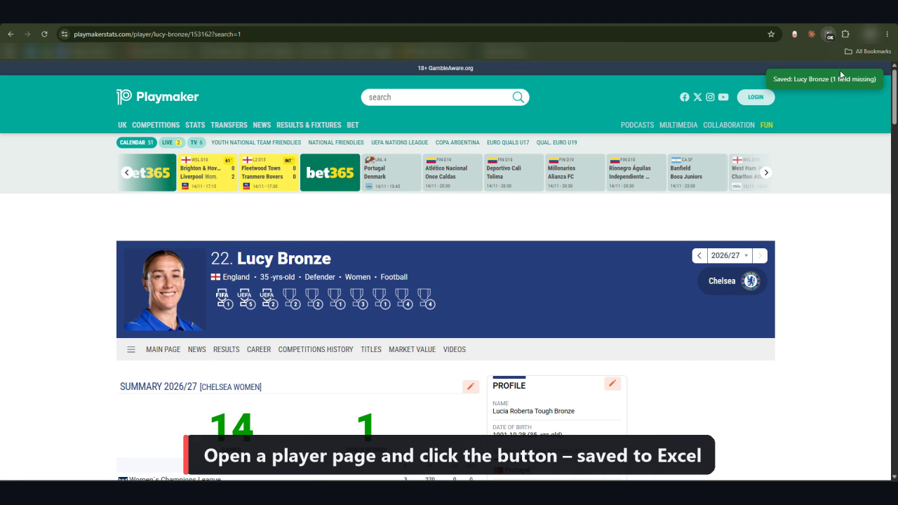
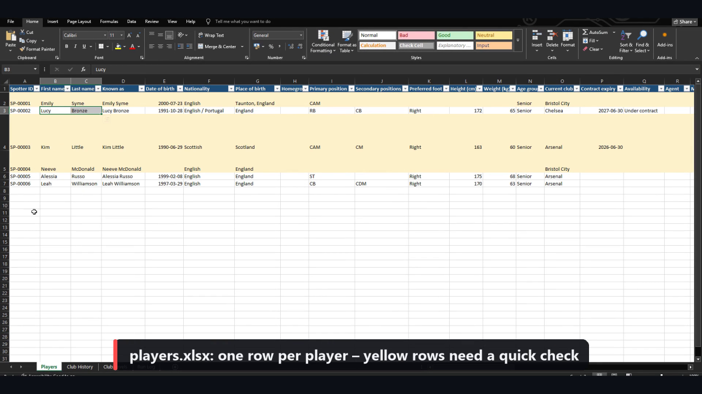
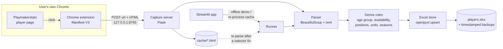
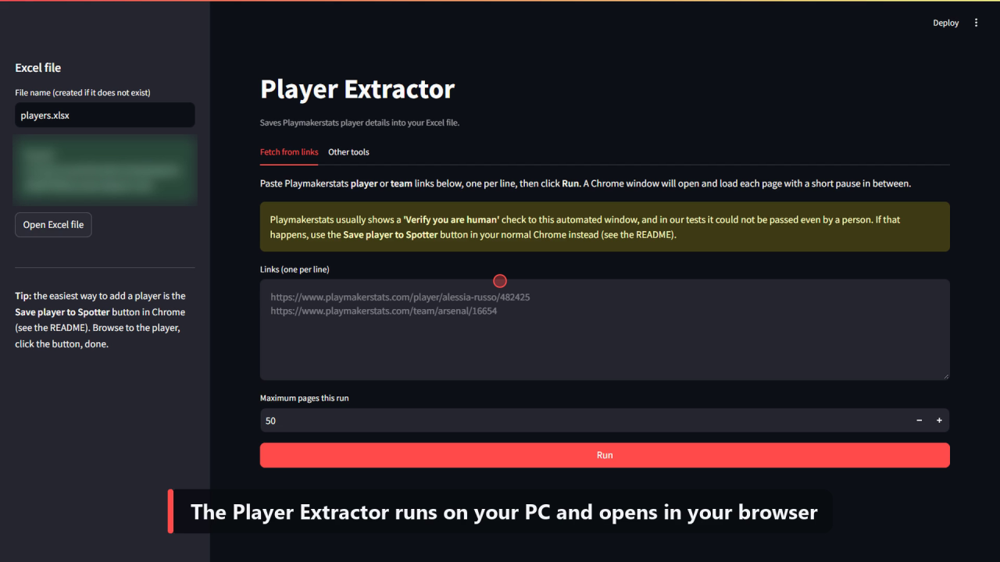
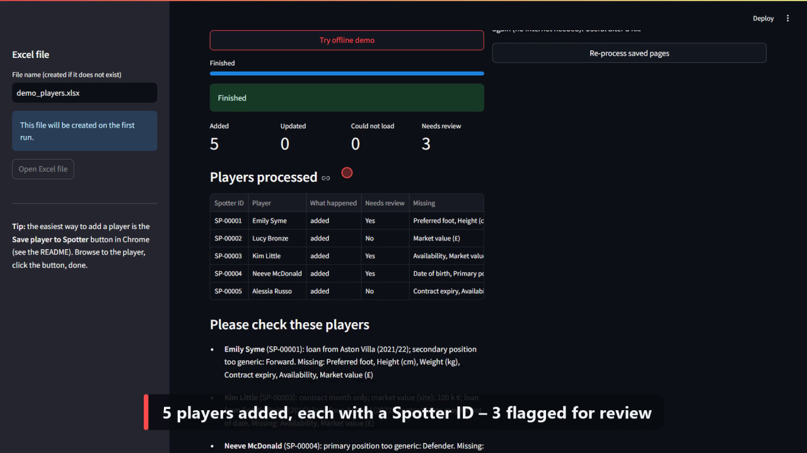

# ⚽ Football Scouting Chrome Extension: Player Extractor

**A Google Chrome extension and Python pipeline. One click on a Playmakerstats player page saves the player into a clean, de-duplicated Excel scouting database.**

[](https://github.com/xdityxrxne/football-scouting-chrome-extension/actions/workflows/ci.yml)


Built for a UK women's football scouting team: non-technical users who were copying player
profiles into spreadsheets by hand. Scouts browse as usual and click **Save player to Spotter** in
the Chrome toolbar. The Python back end parses the page, normalises every field
(positions to codes, heights to cm, seasons to `YYYY/YY`, …), flags anything uncertain for review
and upserts it into a styled Excel workbook. No data is ever guessed or duplicated.

<p align="center">
  
  
</p>

🎬 **[Watch the 1:44 demo video](docs/demo.mp4)**  ·  📘 **[Client user guide (PDF)](docs/Player-Extractor-User-Guide.pdf)**

---

## Highlights

| | |
|---|---|
| 🧭 **Chrome extension (Manifest V3)** | A toolbar button captures the page the scout is viewing, posts it to a localhost Flask service and shows an in-page toast ("Saved: Lucy Bronze (1 field missing)"). It uses the minimal `activeTab` + `scripting` permissions. |
| 🧩 **Pure, tested parser** | `parse_player(html, url)` is side-effect free and tested against 5 real saved player pages and 2 squad pages, field by field. |
| 🔁 **Idempotent upsert** | Stable `SP-00001` IDs; re-saving a player updates the row, replaces their club history and never creates duplicates. |
| 🛡️ **Never guesses** | Missing data stays blank and is listed in *Missing fields*; ambiguous values (e.g. a generic "Defender") are flagged *Needs review* with the raw value in Notes. |
| ✍️ **Respects user edits** | Tool notes are prefixed `(auto)` and regenerated; the client's own notes, club levels and hand-filled cells are never overwritten. |
| 🧑‍💻 **Human-in-the-loop by design** | A Manifest V3 Chrome extension captures the page the user is already viewing. No bot-protection bypass of any kind. |
| 🪟 **One-click for non-technical users** | `run.bat` finds a compatible Python, builds a venv, installs everything and opens the app. A Desktop shortcut does the rest. |
| 🔧 **Maintainable** | Every CSS selector, label and mapping lives in one file (`config.py`), so a site change is a one-file fix, caught by the tests. |

## How it works



1. **Capture:** the user browses normally and clicks **Save player to Spotter**. The extension sends the page's URL and HTML to a localhost-only Flask endpoint.
2. **Parse:** `parser.py` reads the profile card, header and career table. It merges season rows into spells (handling loans, mid-season moves and US calendar-year seasons) and returns a typed `PlayerRecord` plus `Spell`s.
3. **Derive:** `derive.py` applies the business rules: age group from DOB, contract availability, position codes, nationality labels, unit conversion, and `Missing fields` / `Needs review`.
4. **Store:** `excel_store.py` backs up the workbook, upserts by Spotter ID, then by site player ID, and writes four styled sheets with frozen headers, filters, real dates and review highlighting.

### A design decision worth mentioning

The first version drove a visible Playwright browser through a list of URLs (polite 6–10 s delays,
a 300-page cap, ad blocking, a pause for a human when a check appeared). Live testing showed that
Cloudflare challenges *any* automated browser, even when a real person ticks the box. Rather than
work around the protection, I moved the capture point into the user's own browser with a
one-click extension. It is simpler, it is robust, and it is respectful of the site. The Playwright
path is kept as a secondary option and degrades cleanly.

## Screenshots

| Streamlit app | Run summary |
|---|---|
|  |  |

## Output: the Excel workbook

| Sheet | One row per | Contents |
|---|---|---|
| **Players** | player | Spotter ID, names, DOB, nationality (`English / Portugal`), position codes (`GK…CF`), foot, height/weight, age group, club, contract, availability, URL, *Missing fields*, *Needs review*, *Notes* |
| **Club History** | spell | club, level, from/to season (`2023/24` → `Now`) |
| **Club Levels** | club | client-editable lookup (Professional / Semi-pro / Amateur / Academy) |
| **Run Log** | run | timestamp, mode, processed / added / updated / failed / flagged |

## Tech stack

**Python 3.11** · BeautifulSoup + lxml · openpyxl · Flask · Streamlit · Playwright · Chrome Extension (Manifest V3, vanilla JS) · pytest · ruff · GitHub Actions (Windows + Ubuntu matrix)

## Project structure

```
├── player_extractor/        # the package
│   ├── config.py            # ALL selectors, labels, mappings, limits (one place to fix)
│   ├── parser.py            # pure HTML → PlayerRecord + Spells
│   ├── derive.py            # business rules (pure functions)
│   ├── excel_store.py       # workbook load / upsert / backup / styled save
│   ├── models.py            # dataclasses
│   ├── ids.py               # Spotter ID allocation
│   ├── runner.py            # orchestration shared by app, CLI and server
│   ├── capture_server.py    # localhost endpoint for the extension
│   ├── fetcher.py           # optional Playwright mode (visible, polite, human-in-the-loop)
│   ├── offline.py           # reading saved pages
│   └── logsetup.py
├── extension/               # Chrome MV3 "Save player to Spotter" button
├── app.py                   # Streamlit UI
├── scripts/                 # demo_offline.py, fetch_cli.py
├── tests/                   # 46 tests: parser, rules, upsert, server, URL handling
├── samples/                 # saved player and squad pages used as test fixtures
├── docs/                    # field map, developer notes, user guide (MD + PDF), demo video
├── run.bat                  # one-click launcher for Windows
└── make_shortcut.bat        # creates the Desktop shortcut
```

## Getting started

**End users (Windows):** install Python 3.11, double-click `make_shortcut.bat`, then the
**Player Extractor** Desktop icon. Load `extension/` in `chrome://extensions` (Developer mode →
Load unpacked). Full steps: [docs/USER_GUIDE.md](docs/USER_GUIDE.md).

**Developers:**

```bash
python -m venv .venv
.venv\Scripts\activate            # source .venv/bin/activate on macOS/Linux
pip install -r requirements-dev.txt

pytest                            # 46 tests
ruff check .
python scripts/demo_offline.py    # builds players.xlsx from samples/
streamlit run app.py              # the UI
python -m player_extractor.capture_server   # endpoint for the Chrome extension
```

## Testing

- **Parser:** every sample page is asserted field by field against [docs/FIELD_MAP.md](docs/FIELD_MAP.md), e.g. Bronze `172 cm / 65 kg`, `English / Portugal`, contract `2027-06-30`; a youth player's missing DOB is flagged.
- **Rules:** age-group boundaries (birthday today, U21 edge), availability (expired contract while still listed → flagged), unknown and generic positions, unit conversion, market value currencies, name splitting (`Daphne van Domselaar`).
- **Store:** running twice gives no duplicates and stable IDs; blank values never overwrite data; client notes and club levels survive; backups are created.
- **End to end:** the capture server is exercised through Flask's test client, including rejection of verification and non-player pages.

CI runs lint, tests and the offline demo on **Ubuntu and Windows** with Python 3.11 and 3.12.

## Documentation

- [docs/USER_GUIDE.md](docs/USER_GUIDE.md): plain-English guide for the client ([PDF version](docs/Player-Extractor-User-Guide.pdf))
- [docs/DEVELOPMENT.md](docs/DEVELOPMENT.md): architecture, fixing selectors, running tests
- [docs/FIELD_MAP.md](docs/FIELD_MAP.md): where every field lives in the page HTML, and which fields the site doesn't publish

## Limitations

- Playmakerstats never publishes *Homegrown* or *Agent*, shows contracts as month only and market values in euros only; these are handled explicitly rather than guessed.
- Bulk fetching of whole squads is blocked by the site's bot protection, by design; capture is one click per player.

## License

[MIT](LICENSE)
